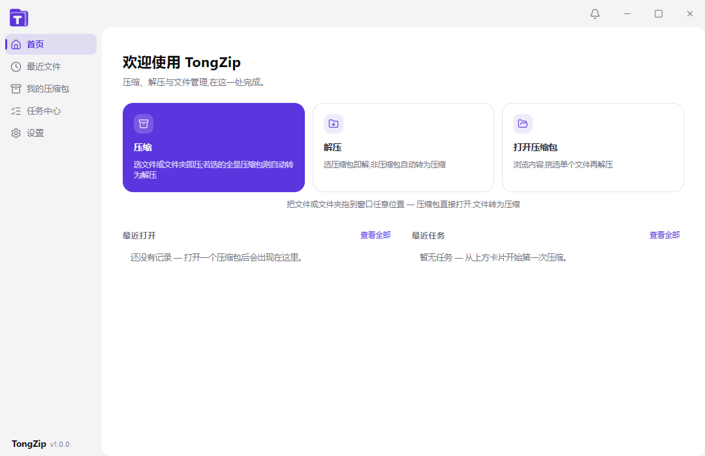

<p align="center">
  
</p>

<h1 align="center">TongZip</h1>

<p align="center">
  Windows 上的现代压缩包管理器：浏览、压缩、解压与任务管理，在这一处完成。
</p>

<p align="center">
  <a href="https://github.com/Wotrix/Tongzip/actions/workflows/gate.yml"></a>
  
  
  
  
</p>



## 为什么是 TongZip

TongZip 不是把 7-Zip 的命令行包一层就结束。它把**压缩包浏览、压缩/解压任务、系统右键菜单和崩溃恢复**放进同一套 Windows 桌面体验里：

- **像文件管理器一样浏览压缩包**：多标签、面包屑、目录树、搜索、详情面板、列宽记忆。
- **任务可见、可控**：压缩/解压启动后立即弹出独立任务窗，实时进度、已用时间、完成后的图标操作；任务中心保留完整历史。
- **默认安全**：就地修改走同目录副本 + 原子 journal；崩溃后启动恢复，不静默重放未确认的任务；解压前做路径穿越、条目数、空间和压缩比防护。
- **Windows 原生集成**：资源管理器右键菜单、文件关联、拖拽打开/压缩、深色/浅色主题。
- **安静但完整**：没有广告和捆绑，界面只保留当前任务需要的信息。

## 功能

### 压缩包

- 同时打开多个压缩包，多标签独立浏览
- 树形目录、面包屑、文件搜索、双击进入目录
- 文件预览、拖拽导出、批量选择
- 添加文件、删除条目、重命名压缩包、测试完整性
- 密码压缩/解压；ZIP 非 ASCII 密码预检提示
- 7Z / ZIP 分卷

### 创建格式

| 格式 | 说明 |
| --- | --- |
| `7z` | 压缩率优先，支持密码、分卷、多线程 |
| `zip` | 兼容性优先，支持密码与分卷 |
| `tar.gz` / `tar.bz2` / `tar.xz` | Linux / macOS 常见分发格式 |
| `tar` | 仅打包，不压缩 |

可打开 7-Zip 21.07 支持的常见归档，包括 7z、zip/zipx、tar、gz、bz2、xz、lzma、cab，以及 apk、jar、docx、xlsx、epub 等基于 ZIP 的容器格式。

### 任务窗

- 压缩、解压、测试、删除统一进度窗口
- 品牌色进度条，完成后停止计时
- 完成后可直接 **打开文件夹**、**打开文件位置**，或点 **完成** 关闭
- 任务中心保留历史记录，支持最近任务右键菜单与单条移除

### 稳定性

- 归档修改使用同目录 `.tztmp` 副本，校验通过后再原子替换
- 崩溃恢复会清理 `.tztmp` 与 7za 的 `.tztmp.tmp`，避免临时文件残留
- 恢复策略区分 staged / swapping / committed；无法确认结果时标记中断，不自动重放
- 解压资源防护：条目数、总大小、压缩比、路径穿越、链接与磁盘空间检查
- CI 在 `windows-latest` 上跑完整门禁：类型检查、自测、打包、产物核查、真实崩溃演练、依赖审计

## 开发

### 环境

- Windows 10 / 11 x64
- Node.js 22+（CI 使用 Node.js 24）
- npm

### 常用命令

```bash
npm ci          # 安装依赖
npm run dev     # Vite + Electron 开发模式
npm run build   # 构建渲染层
npm start       # 运行已构建的 Electron 应用
npm run dist    # 打包 portable + NSIS 安装包到 release/
```

### 质量门禁

```bash
npm run typecheck   # TypeScript 检查
npm run selftest    # 核心逻辑自测
npm run crash       # 真实崩溃演练（Windows）
npm run gate        # 完整六步门禁（Windows）
```

`npm run gate` 是发布前必须通过的完整门禁，包含真实进程强杀与恢复验证； CI 配置见 [.github/workflows/gate.yml](.github/workflows/gate.yml)。

### 产物

```text
release/
  TongZip 1.0.0.exe           # portable
  TongZip Setup 1.0.0.exe     # NSIS 安装包
  win-unpacked/               # 免安装目录
```

> 当前为 1.0.0 RC 阶段；正式安装包发布后可从 GitHub Releases 获取。

## 架构

```text
src/                 React 19 渲染层（首页、压缩包浏览、设置、任务窗）
electron/            Electron 主进程、preload、右键菜单、更新器、归档引擎
shared/types.ts      主进程 / 渲染层共享类型与格式协议
engine/7za.exe       7-Zip 21.07 命令行引擎
scripts/             自测、格式矩阵、崩溃演练、安装探针与质量门禁
docs/                开发说明与阶段验收记录
```

技术栈：Electron 33、React 19、TypeScript 5、Vite 6、Tailwind CSS 4、Radix UI、electron-updater、7-Zip 21.07。

## 说明

- 本仓库源码公开，但 TongZip 本体为闭源软件；未附开源许可证。
- 第三方组件与 7-Zip 许可见 [licenses](licenses/)。
- 反馈与问题请走 GitHub Issues；应用内“关于”页也保留了作者联系方式。

<p align="center">TongZip © 2026 Wotrix</p>
